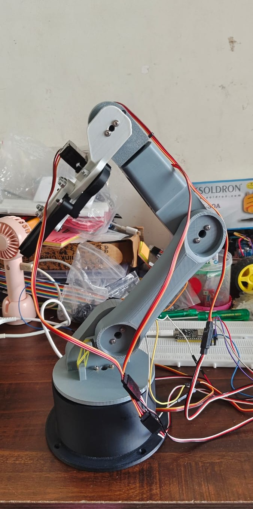
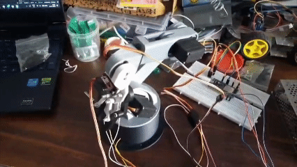
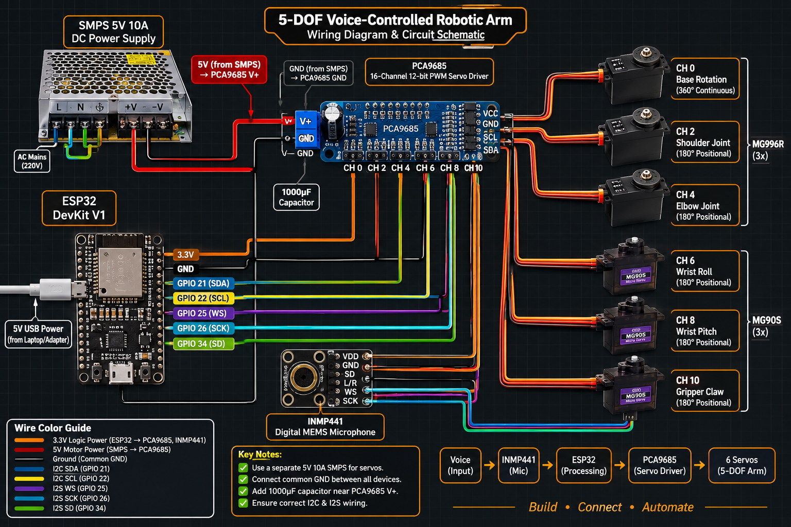
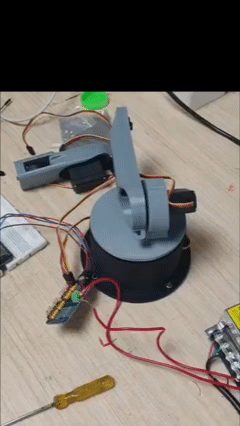
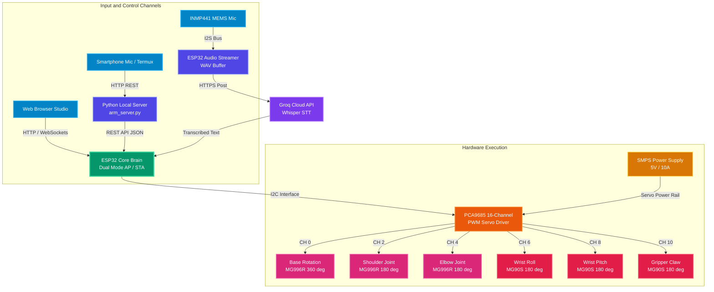

<div align="center">

# Voice-Controlled 5-DOF Robotic Arm

<p align="center">
  
  
  
  
  
  
</p>

<p align="center">
  <b>An articulated 5-DOF robotic arm driven by an ESP32 microcontroller and PCA9685 PWM driver, featuring offline local voice processing in Hindi and English, cloud AI speech transcription, and a browser-based real-time dashboard.</b>
</p>

<p align="center">
  <a href="#project-overview">Overview</a> •
  <a href="#glimpses-of-work">Glimpses of Work</a> •
  <a href="#system-architecture">Architecture</a> •
  <a href="#bill-of-materials-bom">Bill of Materials</a> •
  <a href="#wiring-and-connections">Wiring</a> •
  <a href="#getting-started">Getting Started</a> •
  <a href="#voice-command-reference">Voice Commands</a> •
  <a href="#contributing">Contributing</a> •
  <a href="#license">License</a>
</p>

</div>

---

## Project Overview

This repository contains the complete firmware, host servers, and documentation for a 5 Degrees of Freedom (5-DOF) robotic arm featuring a 2-link articulated kinematic structure. The platform utilizes high-torque MG996R metal-gear servos for heavy primary joints (base, shoulder, elbow) and MG90S micro servos for end-effector manipulation (wrist roll, wrist pitch, gripper).

### Glimpses of Work

<table align="center" width="100%">
  <tr>
    <td align="center" width="50%" valign="top">
      <b>Physical Hardware Assembly</b><br/><br/>
      
    </td>
    <td align="center" width="50%" valign="top">
      <b>Voice Command Execution (Live Demo)</b><br/><br/>
      
    </td>
  </tr>
  <tr>
    <td align="center" width="50%" valign="top">
      <b>Wiring and Circuit Schematic</b><br/><br/>
      
    </td>
    <td align="center" width="50%" valign="top">
      <b>Arm Articulation &amp; Motion Routine (Demo)</b><br/><br/>
      
    </td>
  </tr>
</table>

### Operational Control Modes
The arm supports three distinct operational interfaces:
1. **Local Offline Voice Control (Android Termux / PC)**: High-speed, zero-cloud dependency speech recognition capable of interpreting English and Hindi commands with sub-second execution latency over local Wi-Fi.
2. **Cloud AI Speech Transcription (Groq Whisper API)**: Direct on-chip acoustic capture via an INMP441 I2S MEMS microphone, streaming WAV payloads from the ESP32 directly to the Groq Cloud API for speech-to-text processing.
3. **Interactive Web Dashboard**: An embedded web server hosted directly by the ESP32 that exposes real-time servo sliders, step buttons, and pre-programmed macro postures (Home, Rest, Pick, Place).

---

## System Architecture



---

## Bill of Materials (BOM)

### 1. Actuators
| Component | Model | Quantity | Role | Specifications |
|:---|:---|:---:|:---|:---|
| High-Torque Servo | **MG996R** | 1 | Base Rotation | 360° Continuous Rotation (Dead-stop at pulse 290) |
| High-Torque Servo | **MG996R** | 2 | Shoulder and Elbow | 180° Positional (Metal Gears, high stall torque) |
| Micro Metal-Gear Servo | **MG90S** | 3 | Wrist Roll, Pitch, Gripper | 180° Positional (Compact end-effector control) |

### 2. Electronics and Controllers
| Component | Specification | Role |
|:---|:---|:---|
| Microcontroller | **ESP32 DevKit V1 (30/38-pin)** | Wi-Fi access point, web server, I2S sampler, I2C master |
| PWM Servo Driver | **PCA9685 (16-Channel 12-bit I2C)** | Generates independent PWM signals for all 6 servos |
| Digital Microphone | **INMP441 Omnidirectional MEMS** | Digital I2S microphone for on-board voice acquisition |
| Power Supply | **SMPS (5V DC, 10A output)** | High-current regulated DC supply for servo power rail |

---

## Wiring and Connections

### 1. ESP32 to PCA9685 (I2C)
| ESP32 Pin | PCA9685 Pin | Description |
|:---|:---|:---|
| **GPIO 21** | **SDA** | I2C Data Line |
| **GPIO 22** | **SCL** | I2C Clock Line |
| **3.3V** | **VCC** | Logic Power |
| **GND** | **GND** | Common Ground |
| *External* | **V+** | Connected directly to SMPS +5V Servo Rail |

### 2. ESP32 to INMP441 Microphone (I2S)
| ESP32 Pin | INMP441 Pin | Note |
|:---|:---|:---|
| **GPIO 25** | **WS** (LRCLK) | Word Select |
| **GPIO 26** | **SCK** (BCLK) | Bit Clock |
| **GPIO 34** | **SD** (DIN) | Serial Data (Input-only GPIO) |
| **3.3V** | **VDD** | 3.3V Power |
| **GND** | **GND / L/R** | Ground (L/R tied to GND selects Left Channel) |

### 3. PCA9685 Channel Assignments and Pulse Bounds
| Channel | Joint | Servo Type | Calibrated Working Pulse Range |
|:---:|:---|:---|:---|
| **CH 0** | Base Rotation | 360° Continuous | Center Stop: `290` \| Left: `<290` \| Right: `>290` |
| **CH 2** | Shoulder | 180° Positional | Min: `180` \| Max: `500` \| Home: `~300` |
| **CH 4** | Elbow | 180° Positional | Min: `85` \| Max: `505` \| Home: `~295` |
| **CH 6** | Wrist Roll | 180° Positional | Min CCW: `100` \| Max CW: `472` \| Home: `160` |
| **CH 8** | Wrist Pitch | 180° Positional | Min Down: `95` \| Max Up: `460` \| Home: `252` |
| **CH 10** | Gripper Claw | 180° Positional | Closed (Grip): `380` \| Open: `180` |

---

## Repository Layout

```text
├── .github/
│   ├── ISSUE_TEMPLATE/
│   │   ├── bug_report.md
│   │   └── feature_request.md
│   └── pull_request_template.md
├── firmware/
│   ├── base_calib/                  # Isolated base calibration sketch
│   ├── shoulder_calib/              # Isolated shoulder calibration sketch
│   ├── elbow_calib/                 # Isolated elbow calibration sketch
│   ├── wrist_calib/                 # Isolated wrist pitch calibration sketch
│   ├── roll_calib/                  # Isolated wrist roll calibration sketch
│   ├── gripper_calib/               # Isolated gripper calibration sketch
│   ├── inmp441_test/                # I2S MEMS microphone diagnostic test
│   ├── roboarm_dashboard/           # Wi-Fi manual control web dashboard
│   ├── roboarm_cloud_voice/         # Cloud voice control using Groq Whisper API
│   └── roboarm_phone_offline_voice/ # Offline phone-assisted voice firmware
├── scripts/
│   ├── arm_server.py                # Python speech recognition server for Termux / PC
│   ├── sync_header.py               # Utility to sync HTML into ESP32 PROGMEM header
│   └── web_voice_studio.html        # Responsive frontend for offline voice studio
├── CODE_OF_CONDUCT.md               # Contributor Covenant Code of Conduct
├── CONTRIBUTING.md                  # Development guidelines and PR workflows
├── LICENSE                          # MIT License
├── README.md                        # Master documentation
└── ROBO_ARM_JOURNAL.md              # Hardware testing logs and design notes
```

---

## Getting Started

### Prerequisites
- [Arduino IDE](https://www.arduino.cc/en/software) with the ESP32 board definitions installed.
- Python 3.8+ on a PC or an Android smartphone running [Termux](https://termux.dev/).
- Required Arduino library:
  - `Adafruit PWM Servo Driver Library`

---

### Step 1: Servo Calibration
Before full assembly, calibrate each servo individually to prevent mechanical stress:
1. Open the calibration sketch for the joint (e.g. `firmware/shoulder_calib/shoulder_calib.ino`).
2. Upload the sketch to the ESP32.
3. Connect your device to the Wi-Fi AP broadcasted by the ESP32 (e.g. `RoboArm-Shoulder-Calib`, password `roboarm123`).
4. Navigate to `http://192.168.4.1` in your browser.
5. Identify and note down the safe minimum, maximum, and home pulse values.

---

### Step 2: Option A — Local Offline Voice Control
Recommended for low latency and zero external internet dependency.

1. Flash `firmware/roboarm_phone_offline_voice/roboarm_phone_offline_voice.ino` to the ESP32.
2. In the firmware file, configure your Wi-Fi credentials:
   ```cpp
   const char* HOME_SSID = "YOUR_WIFI_SSID";
   const char* HOME_PASS = "YOUR_WIFI_PASSWORD";
   ```
3. On your host system or Android phone (Termux):
   ```bash
   cd scripts
   pip install flask requests SpeechRecognition
   python arm_server.py
   ```
4. The server runs continuous speech detection and delivers movement instructions to the arm via HTTP endpoints.

---

### Step 3: Option B — Cloud Voice Control (Groq Whisper)
1. Open `firmware/roboarm_cloud_voice/roboarm_cloud_voice.ino`.
2. Configure network parameters and your Groq Cloud API key:
   ```cpp
   const char* WIFI_SSID     = "YOUR_WIFI_SSID";
   const char* WIFI_PASSWORD = "YOUR_WIFI_PASSWORD";
   const char* GROQ_API_KEY  = "YOUR_GROQ_API_KEY_HERE";
   ```
3. Upload to the ESP32. When triggered, the microphone captures speech, encodes a WAV stream, and submits it to Groq Whisper for transcription.

---

### Step 4: Option C — Manual Web Dashboard
1. Flash `firmware/roboarm_dashboard/roboarm_dashboard.ino` to the ESP32.
2. Connect to the access point `RoboArm-Studio` (password `roboarm123`) or identify the assigned station IP address via the Serial Monitor.
3. Navigate to `http://192.168.4.1` to access sliders and macro movement buttons.

---

## Voice Command Reference

The voice processing system includes natural multilingual mappings for English and Hindi:

| Movement / Action | English Triggers | Hindi Triggers (Devanagari / Transliterated) |
|:---|:---|:---|
| **Wake / Awaken** | `"hey robo"`, `"hello robo"`, `"wake up"` | `"uth"`, `"utho"`, `"jag"` |
| **Sleep / Rest** | `"sleep"`, `"relax"`, `"rest"` | `"so jao"`, `"aaram karo"` |
| **Grip / Close** | `"grab"`, `"close"`, `"hold"`, `"catch"` | `"pakad"`, `"pakdo"`, `"band"` |
| **Release / Open** | `"open"`, `"release"`, `"drop"` | `"khol"`, `"kholo"`, `"chhod"` |
| **Base Left** | `"left"`, `"turn left"` | `"baayein"`, `"left ghumo"` |
| **Base Right** | `"right"`, `"turn right"` | `"daayein"`, `"right ghumo"` |
| **Arm Up** | `"up"`, `"lift"` | `"upar"`, `"upar uthao"` |
| **Arm Down** | `"down"`, `"lower"` | `"neeche"`, `"jhuko"` |
| **Wrist Roll** | `"roll left"`, `"roll right"` | `"kalai ghumao"` |
| **Reset / Home** | `"reset"`, `"home"` | `"seedhe ho jao"`, `"home"` |

---

## Contributing

Contributions are welcome. Please read [CONTRIBUTING.md](CONTRIBUTING.md) for details on code style, bounds validation, and pull request procedures.

---

## Code of Conduct

This project adheres to the Contributor Covenant. Please refer to [CODE_OF_CONDUCT.md](CODE_OF_CONDUCT.md) for community standards.

---

## License

Distributed under the **MIT License**. See [LICENSE](LICENSE) for full legal text.

---

## Authors and Maintainers

<table align="center">
  <tr>
    <td align="center" width="200">
      <a href="https://github.com/mahtoyash">
        <br/><br/>
        <b>Yash Mahto</b>
      </a>
      <br/><sub>Lead Developer</sub>
    </td>
    <td align="center" width="200">
      <a href="https://github.com/GodaseAnurag2601">
        <br/><br/>
        <b>Anurag Godase</b>
      </a>
      <br/><sub>Developer</sub>
    </td>
  </tr>
</table>

<div align="center">
  <b>Developed by <a href="https://github.com/mahtoyash">Yash Mahto</a> and <a href="https://github.com/GodaseAnurag2601">Anurag Godase</a></b>
</div>
